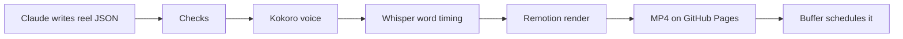

# Axpecto Reels

Short, story-led explainers about SEO, AEO, GEO and AI visibility. Each teaches one real idea and ends with a soft
"Try Axpecto" and axpecto.com. Written by Claude, voiced and rendered in GitHub Actions, posted through Buffer.

Every week: **4 reels, 4 carousel posts and 4 stories**, all from 4 Claude calls.

**Setting it up? Follow [CHECKLIST.md](CHECKLIST.md).**



## Where things live

| Path | What it is |
| --- | --- |
| `brand/brand.json` | Name, URL, product claims, voice, pronunciation, post times |
| `brand/topics.json` | Categories; the least recently used one is picked |
| `brand/channels.json` | Buffer channels to post to |
| `prompts/writer.md` | Claude's brief: story shape, fact rules, "not an ad" rule |
| `episode.schema.json` | Exact shape of a reel; `scripts/write.ts` adds further checks |
| `src/scenes.tsx` | Scene library: hook, browser, ranking, chat, cards, versus, checklist, timeline, cta |
| `src/Stills.tsx` | Carousel slides and story image made from each reel |
| `src/logos.ts`, `public/logos/` | Real logos, shown whenever a brand is named |
| `reels/`, `data/` | Every reel written, plus history and post records |

## Locally

```bash
npm ci
```
```bash
python3 -m venv .venv && .venv/bin/pip install numpy scipy kokoro-onnx faster-whisper
```
```bash
npm run make -- brand/example-reel.json
```
```bash
npm run studio
```

## Logos and licences

Logos are unmodified files from Wikimedia Commons, used only to identify the products named, and remain trademarks of
their owners. To add one, drop its official SVG in `public/logos/` and add a line to `src/logos.ts`.
Remotion is free for individuals and companies of up to 3 people; larger teams need a [company licence](https://remotion.dev/license).
